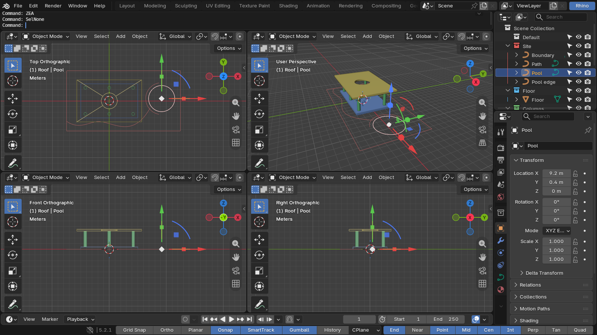
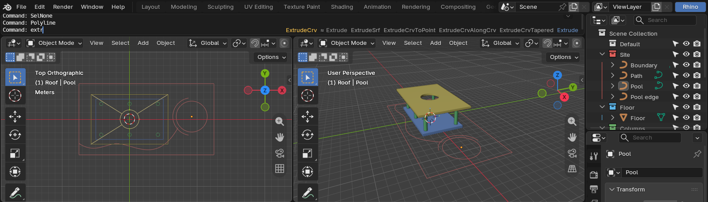
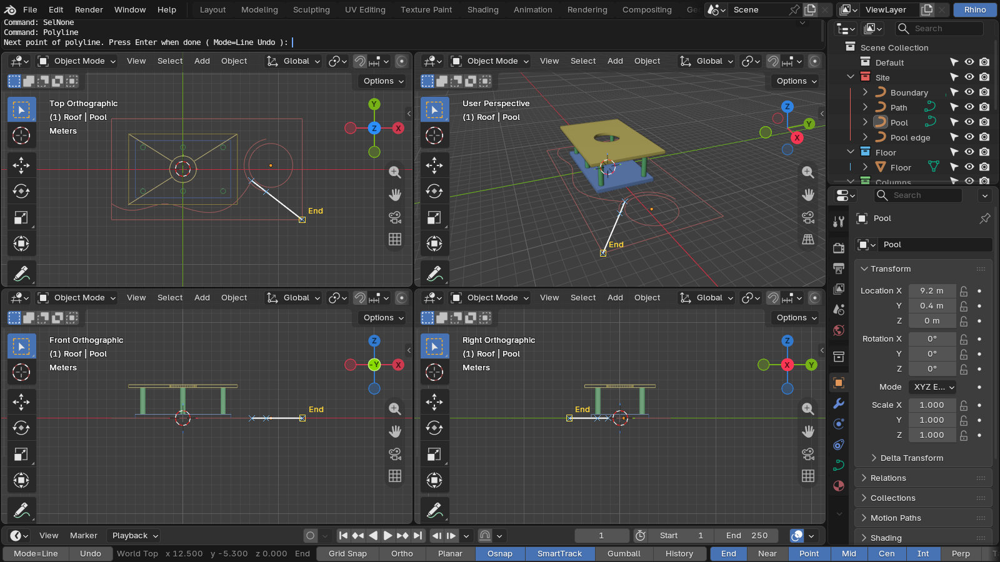

# Rhino Mode

**An unofficial Rhino®-style mode for Blender: navigation, command line, Osnap, CPlane and Gumball, switched on and off with one button.**

[中文说明](README.zh-CN.md)



Rhino Mode is a Blender extension for people who model in Rhino and want to work in Blender with the habits they already have: type a command, pick points with object snaps, read the prompt, press Enter. Turn the mode off and Blender is exactly as it was: the extension does not write to your preferences, theme or keymap.

> Rhinoceros and Rhino are registered trademarks of Robert McNeel & Associates. This is an independent project: it is not affiliated with, sponsored by or endorsed by Robert McNeel & Associates or the Blender Foundation.

**Status:** early development (version 0.1.0). Tested on Blender 4.2 LTS and 5.2 LTS, on Windows.

## Install

**From inside Blender** (updates arrive there too):

1. **Edit > Preferences > Get Extensions**: open **Repositories** at the top right, press **+** and choose **Add Remote Repository**.
2. Paste this URL, tick **Check for Updates on Startup**, and press **Create**:

   ```
   https://ren18161849172-byte.github.io/rhino-mode/index.json
   ```

3. Search for **Rhino Mode** in Get Extensions and press **Install**.

Blender has to be allowed online for this (**Preferences > System > Network > Allow Online Access**). The URL is this project's own extension repository, not extensions.blender.org.

If `github.io` is slow or cannot be reached on your network, use one of these mirrors of the same repository instead (served by jsDelivr; after a release they can take some hours to catch up):

```
https://fastly.jsdelivr.net/gh/ren18161849172-byte/rhino-mode@gh-pages/index.json
https://gcore.jsdelivr.net/gh/ren18161849172-byte/rhino-mode@gh-pages/index.json
```

**From a zip:**

1. Download `r2b-<version>.zip` from the [Releases](../../releases) page.
2. In Blender: **Edit > Preferences > Get Extensions**, open the menu at the top right and choose **Install from Disk...**, then pick the zip.

Either way, turn the mode on with the **Rhino** button in the top bar, with **Edit > Toggle Rhino Mode**, or with **Ctrl+Shift+Alt+R**. The same switch turns it off.

To build the zip from source:

```bash
blender --command extension build --source-dir src/r2b --output-dir dist
```

Blender 4.2 LTS or newer is required.

## What you get

**Workspace**

- Four viewports (Top, Perspective, Front, Right), each with its own display mode, under a command line. Double-click a viewport title to maximize or restore it; click the title for the viewport menu (views, display modes, CPlane, zoom extents).
- Right mouse button navigation: drag to rotate in perspective views and to pan in parallel views, Shift+drag pans, Ctrl+drag zooms. A right click is Enter.
- Layers: the Outliner works as the Layers panel (Blender collections), with a current layer, layer colors, and new, sub-, delete and move buttons.

**Command line**

- Type in a viewport: `Move`, `Box`, `ZE`, `SelNone`... Enter or Space runs the command, an empty line repeats the last one, Tab completes.
- Prompts with options, as in Rhino (`Copy=Yes`, `Undo`); the options are also buttons in the status bar.
- Coordinates: `3,4`, `@3,4`, `5<30`, `@5<30`; a distance or `<angle` alone constrains the next point.
- Rhino names and Blender names: `Extrude`, `Inset`, `LoopCut`, `Knife`, `ShadeSmooth` run Blender's tools, and any Blender operator can be typed by its label. Where the two programs use one name for different things (`Scale`, `Split`, `Array`...), the bare word is Rhino's and `b:Scale` is Blender's (a preference turns this round).
- Aliases, with presets for Rhino's defaults and for Blender's single keys.



**Picking points**

- Osnap (End, Near, Point, Mid, Cen, Int, Perp, Tan, Quad), Grid Snap (F9), Ortho (F8), Planar and SmartTrack, with toggles in the status bar. Alt picks without snapping; typing `end`, `mid`... snaps the next point only.
- CPlane per viewport: origin, 3Point, Elevation, Object, Rotate, View, World, Undo.
- Gumball: move, rotate and scale handles on the selection, aligned to the CPlane, the object or the world. Drag with Osnap, or click a handle and type a value. Ctrl+drag an arrow to extrude.



**Selecting**

- Drag left to right for a window selection, right to left for a crossing selection; Shift adds, Ctrl removes. Drag an object to move it.
- Ctrl+Shift+click picks faces, edges and points of a mesh (sub-objects).
- `SelCrv`, `SelMesh`, `SelLast`, `SelPrev`, `SelDup`, `SelLayer`, `Lasso`, `Lock`, `Isolate`, `HideSwap`.

**Curves** (exact: lines stay lines, circles and arcs stay true arcs)

- Draw: `Line`, `Polyline`, `Curve`, `InterpCrv`, `Circle`, `Arc`, `Rectangle`, `Ellipse`, `Polygon`.
- Edit: `Trim`, `Split`, `Join`, `Explode`, `Extend`, `Fillet`, `Chamfer`, `Offset`.

**Transforms**

- `Move`, `Copy`, `Rotate`, `Scale`, `Scale1D`, `Scale2D`, `ScaleNU`, `Mirror`, `Orient`, `Orient3Pt`, `Shear`, `ProjectToCPlane`, `SetPt`, `Align`, `Distribute`, on objects and on mesh or curve points in Edit Mode.
- `Twist`, `Taper`, `Stretch`, `Bend`; `Array`, `ArrayLinear`, `ArrayPolar`, `ArrayCrv`.

**Surfaces and solids** (the results are meshes)

- `Box`, `Sphere`, `Cylinder`, `Cone`, `Plane`, `Torus`, picked point by point as in Rhino.
- `ExtrudeCrv`, `ExtrudeSrf`, `ExtrudeCrvToPoint`, `ExtrudeCrvAlongCrv`, `ExtrudeCrvTapered`, `Slab`, `PlanarSrf`, `Cap`, `Revolve`, `Loft`, `Sweep1`, `Pipe`.
- `PushPull`, `MoveFace`; `BooleanUnion`, `BooleanDifference`, `BooleanIntersection`, `BooleanSplit`; `FilletEdge`, `ChamferEdge`, `Shell`, `OffsetSrf`, `ExtractSrf`; `Trim` and `Split` on meshes, with `Cap`.
- Record History (status bar): extrusions, booleans, arrays and deformations stay linked to their input through Blender modifiers.

**Measuring**

- `Distance`, `Angle`, `Length`, `Area`, `Volume`, `Radius`, `What`, `BoundingBox`.

Type `Commands` in the command line for the full list.

## What it does not do

- Surface and solid commands make meshes, not NURBS surfaces.
- There is no `.3dm` import or export yet.
- Commands are typed with a Latin keyboard layout; input methods (IME) have not been tested.
- It has only been tested on Windows.

## Leaves no traces

- Nothing is written to Blender's preferences, themes or keymaps. Blender's own shortcuts that would clash are switched off in memory only while the mode is on.
- No network access. The only file the extension writes itself is an optional debug log (`r2b_debug.log` in the system temp folder, with mouse button events), off by default.
- A file saved while the mode is on keeps a "Rhino" workspace tab. Opened without the extension it is an ordinary workspace; turning the mode on and off removes it.

## Development

```
src/r2b/     the extension (blender_manifest.toml is here)
tools/       build_workspace.py makes the four-view layout asset
```

`r2b` is the extension's technical name: its id, its Python package and the prefix of its operators (`r2b.move`).

The code has two layers. CORE (`prefs.py`, `switch.py`, `debug.py`) is always registered, so the mode can always be turned off. Everything else is a feature module with `register()` and `unregister()`, listed in `mode.py` and registered all together when the mode is turned on.

To rebuild the workspace asset (with Blender 4.2, so that every newer version can read it):

```bash
blender --factory-startup --python tools/build_workspace.py -- src/r2b/assets/rhino_workspace.blend
```

The maintainer runs a regression suite on Blender 4.2 LTS and the current release before each release; it is not part of this repository. See [CONTRIBUTING.md](CONTRIBUTING.md) for how to check a change by hand.

## Contributing

Bug reports and pull requests are welcome. Please read [CONTRIBUTING.md](CONTRIBUTING.md) first.

## Acknowledgements

The design owes ideas to [Maya Workflow Kit for Blender](https://github.com/5hyuns/maya-workflow-kit-for-blender) (the always-on core and switchable mode, keymap handling, the four-view workspace), Snap Line Tool (snapping), Precision Drawing Tools (coordinate input) and CAD Sketcher (work planes).

This extension was developed with the help of an AI coding assistant (Anthropic's Claude). Changes were tested in Blender 4.2 LTS and 5.2 LTS.

## License

GPL-3.0-or-later, see [LICENSE](LICENSE).
