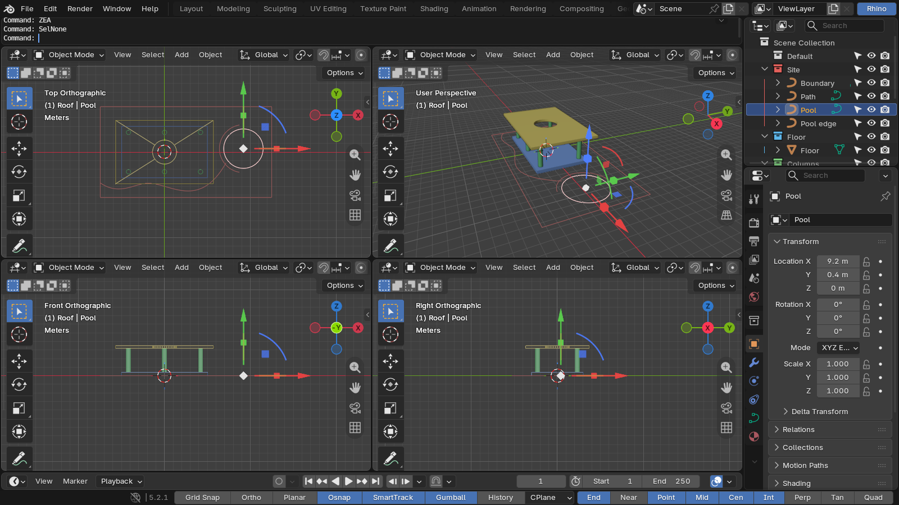
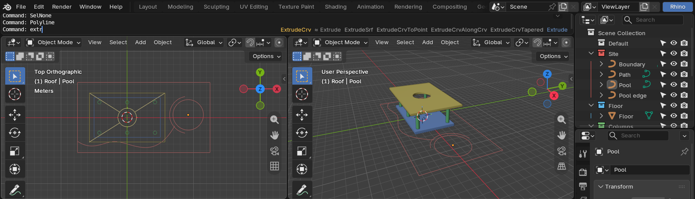
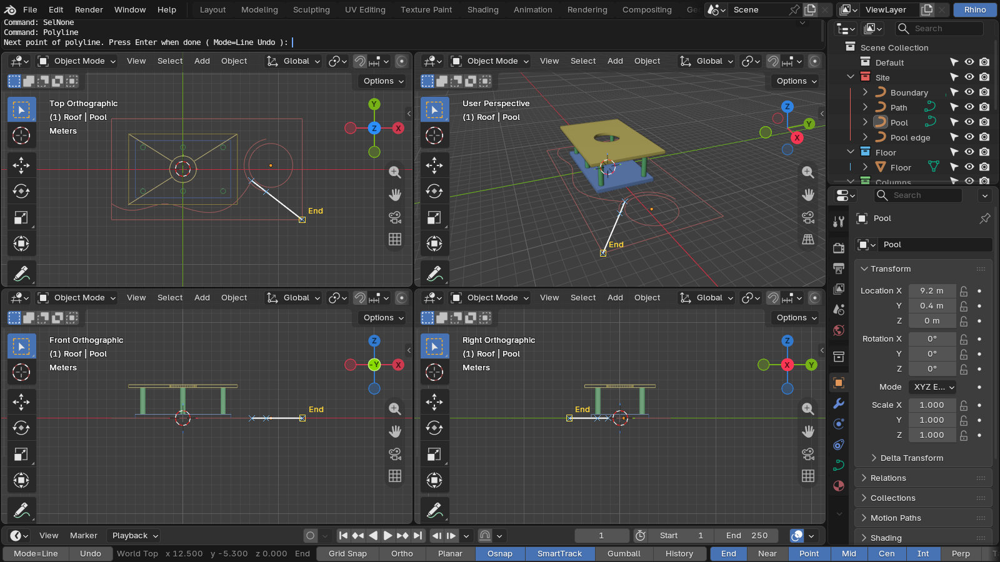

# Rhino Mode

**非官方的 Rhino® 风格 Blender 模式：导航、命令行、Osnap、CPlane 和 Gumball，一个按钮开关。**

[English](README.md)



Rhino Mode 是一个 Blender 扩展，给习惯用 Rhino 建模的人用：输入命令、用物件锁点取点、看提示、按回车，在 Blender 里照原来的习惯工作。关掉这个模式，Blender 和原来完全一样：扩展不会改动你的偏好设置、主题和键位。

> Rhinoceros、Rhino 是 Robert McNeel & Associates 的注册商标。这是一个独立项目，与 Robert McNeel & Associates 及 Blender 基金会没有关联，也未获得其赞助或认可。

**状态：** 早期开发（版本 0.1.0）。在 Windows 上的 Blender 4.2 LTS 和 5.2 LTS 测试过。

## 安装

1. 在 [Releases](../../releases) 页面下载 `r2b-<版本>.zip`。
2. 在 Blender 里：**编辑 > 偏好设置 > 获取扩展**，点右上角的菜单，选 **从磁盘安装...**（Install from Disk），选中这个 zip。
3. 用顶栏的 **Rhino** 按钮、**编辑 > Toggle Rhino Mode** 或 **Ctrl+Shift+Alt+R** 打开模式，再按一次关闭。

从源码打包：

```bash
blender --command extension build --source-dir src/r2b --output-dir dist
```

需要 Blender 4.2 LTS 或更新的版本。

## 有什么功能

**工作区**

- 命令行下面是四个视口（Top、Perspective、Front、Right），各自有独立的显示模式。双击视口标题最大化或还原，单击标题弹出视口菜单（视图、显示模式、CPlane、缩放至全部）。
- 右键导航：透视视图里拖动旋转，平行视图里拖动平移；Shift+拖动平移，Ctrl+拖动缩放。右键单击等于回车。
- 图层：大纲视图用作图层面板（Blender 的集合），有当前图层、图层颜色，以及新建、子图层、删除、上移下移的按钮。

**命令行**

- 在视口里直接打字：`Move`、`Box`、`ZE`、`SelNone`……回车或空格执行，空行重复上一条命令，Tab 补全。
- 和 Rhino 一样带选项的提示（`Copy=Yes`、`Undo`），选项同时是状态栏上的按钮。
- 坐标：`3,4`、`@3,4`、`5<30`、`@5<30`；只输入距离或 `<角度` 则约束下一个点。
- Rhino 和 Blender 两套名字：`Extrude`、`Inset`、`LoopCut`、`Knife`、`ShadeSmooth` 运行 Blender 的工具，任何 Blender 算子都可以按它的标签名输入。两边同名但意思不同的（`Scale`、`Split`、`Array`……），不加前缀是 Rhino 的意思，`b:Scale` 是 Blender 的（偏好设置里可以反过来）。
- 别名，可一键加入 Rhino 的默认别名或 Blender 的单键别名。



**取点**

- Osnap（端点、最近点、点、中点、中心点、交点、垂直点、切点、四分点）、锁定格点（F9）、正交（F8）、平面模式和智慧轨迹，状态栏有开关。按住 Alt 暂时不锁点；输入 `end`、`mid` 等只对下一个点生效。
- 每个视口有自己的 CPlane：原点、3Point、Elevation、Object、Rotate、View、World、Undo。
- Gumball：选中的东西上显示移动、旋转、缩放手柄，可对齐 CPlane、物体或世界。拖动时可以锁点，也可以单击手柄后输入数值。Ctrl+拖动箭头是挤出。



**选择**

- 从左往右拖是窗选，从右往左拖是交叉选；Shift 加选，Ctrl 减选。在物体上拖动直接移动它。
- Ctrl+Shift+单击选网格的面、边、点（子物件）。
- `SelCrv`、`SelMesh`、`SelLast`、`SelPrev`、`SelDup`、`SelLayer`、`Lasso`、`Lock`、`Isolate`、`HideSwap`。

**曲线**（结果是精确的：直线仍是直线，圆和弧仍是真正的圆弧）

- 绘制：`Line`、`Polyline`、`Curve`、`InterpCrv`、`Circle`、`Arc`、`Rectangle`、`Ellipse`、`Polygon`。
- 编辑：`Trim`、`Split`、`Join`、`Explode`、`Extend`、`Fillet`、`Chamfer`、`Offset`。

**变换**

- `Move`、`Copy`、`Rotate`、`Scale`、`Scale1D`、`Scale2D`、`ScaleNU`、`Mirror`、`Orient`、`Orient3Pt`、`Shear`、`ProjectToCPlane`、`SetPt`、`Align`、`Distribute`，作用于物体，也作用于编辑模式里的网格点和曲线点。
- `Twist`、`Taper`、`Stretch`、`Bend`；`Array`、`ArrayLinear`、`ArrayPolar`、`ArrayCrv`。

**曲面和实体**（结果是网格）

- `Box`、`Sphere`、`Cylinder`、`Cone`、`Plane`、`Torus`，和 Rhino 一样逐点取。
- `ExtrudeCrv`、`ExtrudeSrf`、`ExtrudeCrvToPoint`、`ExtrudeCrvAlongCrv`、`ExtrudeCrvTapered`、`Slab`、`PlanarSrf`、`Cap`、`Revolve`、`Loft`、`Sweep1`、`Pipe`。
- `PushPull`、`MoveFace`；`BooleanUnion`、`BooleanDifference`、`BooleanIntersection`、`BooleanSplit`；`FilletEdge`、`ChamferEdge`、`Shell`、`OffsetSrf`、`ExtractSrf`；`Trim`、`Split` 也能切网格，带 `Cap` 选项。
- 记录建构历史（状态栏）：挤出、布尔、阵列和变形的结果通过 Blender 的修改器保持和输入关联。

**测量**

- `Distance`、`Angle`、`Length`、`Area`、`Volume`、`Radius`、`What`、`BoundingBox`。

在命令行输入 `Commands` 查看全部命令。

## 目前不能做的

- 曲面和实体命令生成的是网格，不是 NURBS 曲面。
- 还不能导入或导出 `.3dm`。
- 命令要在英文输入状态下输入；输入法（IME）下的表现还没有测试过。
- 只在 Windows 上测试过。

## 不留痕迹

- 不写 Blender 的偏好设置、主题和键位。会冲突的 Blender 快捷键只在模式开着时在内存里屏蔽。
- 不联网。扩展自己只会写一个文件：可选的调试日志（系统临时目录里的 `r2b_debug.log`，记录鼠标按键事件），默认关闭。
- 开着模式保存的文件会带一个 “Rhino” 工作区标签页。没装这个扩展时打开，它就是一个普通的工作区；开关一次模式会把它删掉。

## 开发

```
src/r2b/     扩展本体（blender_manifest.toml 在这里）
tools/       build_workspace.py 生成四视图布局的资产文件
```

`r2b` 是扩展的技术名称：它的 id、Python 包名和算子前缀（`r2b.move`）。

代码分两层。CORE（`prefs.py`、`switch.py`、`debug.py`）始终注册，保证模式总能关掉。其余每个功能是一个带 `register()`、`unregister()` 的模块，列在 `mode.py` 里，打开模式时一起注册。

重新生成工作区资产（用 Blender 4.2 生成，这样更新的版本都能读）：

```bash
blender --factory-startup --python tools/build_workspace.py -- src/r2b/assets/rhino_workspace.blend
```

每次发布前，维护者会在 Blender 4.2 LTS 和当前版本上跑一套回归测试；这套测试不在本仓库里。手动检查改动的方法见 [CONTRIBUTING.md](CONTRIBUTING.md)。

## 参与贡献

欢迎报告问题和提交 PR，请先读 [CONTRIBUTING.md](CONTRIBUTING.md)。

## 致谢

设计上参考了 [Maya Workflow Kit for Blender](https://github.com/5hyuns/maya-workflow-kit-for-blender)（常驻核心加可开关的模式、键位处理、四视图工作区）、Snap Line Tool（捕捉）、Precision Drawing Tools（坐标输入）和 CAD Sketcher（工作平面）。

本扩展在 AI 编程助手（Anthropic 的 Claude）的协助下开发，改动都在 Blender 4.2 LTS 和 5.2 LTS 上测试过。

## 许可

GPL-3.0-or-later，见 [LICENSE](LICENSE)。
